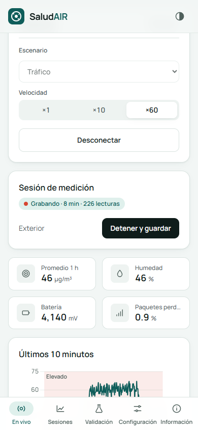
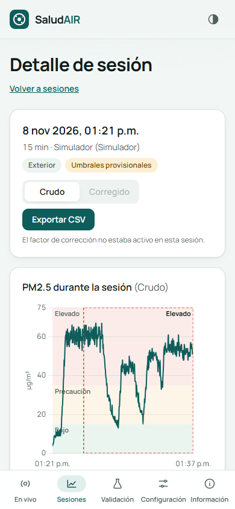
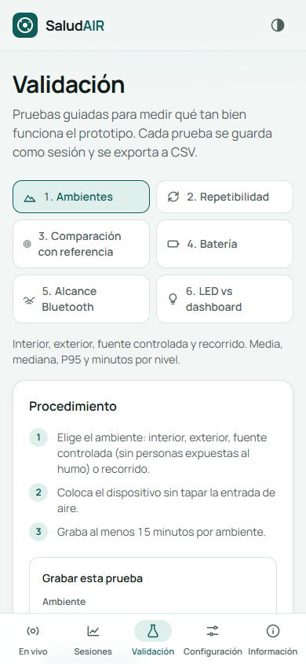

# SaludAIR — PM2.5 dashboard

Installable web app (PWA) for **SaludAIR**, a low-cost wearable PM2.5 monitor for people
with asthma in Mexicali / Valle de Mexicali (Chemistry course project, CETYS Universidad —
Ángel Amaya, Román Meza, Clío Parra, Raúl Solís).

**Live app:** https://lexangel05.github.io/saludair/ (open it in Chrome/Edge on a computer or Chrome on Android; install it as an app from the browser menu).

> SaludAIR es un prototipo educativo. Sus lecturas son aproximadas y no sustituyen la
> indicación de un profesional de salud ni las estaciones oficiales de monitoreo.

| En vivo | Sesión | Validación |
|---|---|---|
|  |  |  |

## What it does

* Connects to the device over **Bluetooth** (Chrome/Edge desktop, Chrome Android) or **USB**
  (desktop), or runs a built-in **Simulator** — no hardware needed to try it.
* Shows the 1-minute PM2.5 value, the exposure level from the 5-minute mean
  (Bajo / Precaución / Elevado, always with text), and data-quality flags (disconnected,
  stale, packet loss, high humidity, warm-up, reboot, low battery).
* Alerts only when the 5-minute mean stays high for 2 minutes (a single spike never alerts),
  with hysteresis and a 10-minute cooldown. Banner + system notification + vibration.
* Records sessions with tags, shows charts and summaries, exports CSV (with the settings
  used) and full JSON backups.
* **Validation** page with guided tests: environments, repeatability, comparison against a
  reference station (bias, MAE, RMSE, r, R², fit), battery, Bluetooth range, LED vs dashboard.
* Works **offline** after the first visit. Data never leaves the browser.

## For the hardware team

Everything the ESP32 firmware must send is in **[docs/firmware-contract.md](docs/firmware-contract.md)**
(UUIDs, line format, LED thresholds, Arduino pseudocode, self-test).

## Run it locally

Requires Node.js 22+ and npm.

```bash
npm install
```

```bash
npm run dev
```

Open http://localhost:5173 → **En vivo → Simulador**. Choose "Tráfico" and ×60 to see an alert
within a few seconds.

Bluetooth and USB need **Chrome or Edge** and a secure origin (`localhost` or HTTPS).
On a phone, use the deployed HTTPS URL.

## Commands

| Task | Command |
|---|---|
| Dev server | `npm run dev` |
| Unit tests (Vitest) | `npm run test` |
| End-to-end tests (Playwright, uses installed Chrome) | `npm run test:e2e` |
| Lint / types | `npm run lint` · `npm run typecheck` |
| WCAG contrast check | `npm run check:contrast` |
| Production build / preview | `npm run build` · `npm run preview` |
| Regenerate screenshots | `SCREENSHOTS=1 npx playwright test screenshots` |

## Deploy

* **GitHub Pages:** push to `main`; `.github/workflows/deploy.yml` lints, tests, builds with
  `BASE_PATH=/<repo>/` and publishes. One-time: repo *Settings → Pages → Source: GitHub Actions*.
* **Vercel / Netlify:** framework "Vite", build `npm run build`, output `dist`. No extra config
  (hash routing, base `/`).

## Testing status

* 170+ unit tests (parser, sequence/loss, averages, levels, alert state machine, quality flags,
  statistics, CSV/backup, reference alignment incl. time zones, validation metrics, BLE/serial
  sources with fakes, recorder on IndexedDB).
* E2E: Simulator → session → alert → summary → CSV download.
* Real hardware, Android and notifications: see **[docs/manual-test-checklist.md](docs/manual-test-checklist.md)**.

## Project docs

* [AGENTS.md](AGENTS.md) — full specification, measurement methodology, decisions, status.
  Source of truth for anyone (human or AI) continuing the project.
* [docs/firmware-contract.md](docs/firmware-contract.md) · [docs/manual-test-checklist.md](docs/manual-test-checklist.md)
